# 나의 퀴즈 게임

## 프로젝트 개요
Python 표준 라이브러리만 사용한 터미널 기반 4지선다 퀴즈 게임입니다.
퀴즈를 풀고 직접 문제를 추가하며, 등록한 문제와 최고 점수를 JSON 파일로 유지합니다.
`Quiz`는 문제 하나를, `QuizGame`은 메뉴·게임 진행·점수·파일 입출력을 담당합니다.

## 과제 목표 및 학습 성취도

이 프로젝트를 통해 아래의 핵심 개념들을 실습하고 습득하였습니다.

### 1. Python 기초
- **변수와 자료형**: `int`(점수, 번호), `str`(문제, 힌트), `bool`(정답 여부), `list`(퀴즈 목록), `dict`(JSON 데이터 구조)의 차이를 이해하고 적재적소에 활용했습니다.
- **조건문 (`if/elif/else`)**: 메뉴 선택 분기 및 정답 비교 로직에서 조건에 따른 동작을 구현했습니다.
- **반복문 (`for`, `while`)**: 
    - `for`: 선택지 출력 및 퀴즈 목록 순회에 사용했습니다.
    - `while`: 사용자 입력 검증(무한 루프와 break) 및 메인 게임 루프 유지에 사용했습니다.
- **함수 정의**: `read_number`, `read_non_empty_text`와 같이 매개변수와 반환값을 가진 함수를 만들어 코드 중복을 제거했습니다.

### 2. 클래스와 객체 (OOP)
- **클래스 설계**: `Quiz`와 `QuizGame` 클래스를 정의하여 데이터와 기능을 논리적으로 묶었습니다.
                    클래스는 한마디로 "객체를 만들기 위한 설계도" 입니다.
- **`__init__`과 `self`**: 객체 생성 시 초기 상태를 설정하고, `self`를 통해 인스턴스 변수와 메서드에 접근하는 원리를 익혔습니다.
- **클래스(설계도)** : 붕어빵 틀, 자동차 설계도, 아파트 도면
- **인스턴스(객체)** : 틀에서 구워낸 붕어빵, 실제로 도로를 달리는 자동차, 우리가 살고 있는 아파트
- **그렇다면 클래스는 왜 사용할까?**
  1. 데이터와 기능을 하나로 묶기 위해 (캡슐화)
  2. 코드의 재사용성 (붕어빵 틀)
  3. 유지보수가 쉬워짐
- **속성(Attribute)과 메서드(Method)**: 퀴즈의 데이터(속성)와 정답 확인/출력(메서드) 기능을 분리하여 관리했습니다.
- **속성(Attribute)** : 객체가 가지고 있는 데이터나 상태를 의미. (명사형), self.변수명 형태로 정의.
                        비유 : 자동차의 색상, 모델명, 연료량
- **메서드(Method)** : 객체가 할 수 있는 동작이나 기능을 의미. (동사형), 정의된 함수이며, 첫 번째 매개변수로 항상 self를 받는다.
                        비유 : 주행하기, 멈추기, 경적 울리기

### 3. 파일 입출력 및 예외 처리
- **파일 읽기/쓰기**: `pathlib`과 `json` 모듈을 사용하여 데이터를 영구적으로 저장하고 불러오는 과정을 구현했습니다.
- **JSON 형식**: 키-값 쌍으로 이루어진 JSON 구조가 데이터 저장과 교환에 왜 유리한지 실습했습니다.
- **예외 처리 (`try/except`)**: 파일이 없거나 데이터가 손상된 경우, 잘못된 입력을 한 경우에도 프로그램이 강제 종료되지 않도록 예외를 처리했습니다.

### 4. Git 기초 및 협업
- **기본 명령어**: `init`으로 저장소를 시작하고, `add`/`commit`으로 변경사항을 기록하며, `push`/`pull`로 원격 저장소와 동기화했습니다.
- **브랜치와 병합**: `feature/play` 브랜치를 생성하여 기능을 개발하고 `main` 브랜치에 병합하는 워크플로우를 경험했습니다.
- **원격 저장소 활용**: GitHub에 저장소를 생성하고, `clone`을 통해 다른 환경에서 프로젝트를 복제하여 작업하는 과정을 실습했습니다.

## 클래스 사용 이유와 책임 분리

### 왜 Quiz와 QuizGame을 클래스로 만들었는가

`Quiz`는 문제·선택지·정답·힌트를 하나의 개념으로 **추상화**합니다.
여러 리스트에 문제와 정답을 따로 보관하면 추가·삭제할 때 서로 다른 문제의 데이터가 섞일 수 있습니다.
한 객체가 자신의 데이터와 출력·정답 판정을 함께 가지게 하여 이러한 실수를 줄입니다.
문제 5개든 1,000개든 동일한 생성자와 메서드를 **재사용**할 수 있고,
힌트 같은 속성 추가 시 모델이 바뀌는 위치도 분명해집니다.

`QuizGame`은 퀴즈 목록·최고 점수·완료 횟수·기록의 상태와 이를 다루는 기능을 묶습니다.
전역 변수를 여러 함수가 바꾸는 방식보다 상태가 어디에서 변경되는지 추적하기 쉽습니다.
테스트에서는 `QuizGame(임시_저장_경로)`를 만들어 실제 사용자 데이터와 분리하여 재사용합니다.
다만 현재 콘솔 UI와 저장소 구현은 같은 클래스 안에 있으므로 웹 UI나 다른 저장소를 도입할 때는
입력·출력 계층과 저장소 클래스를 추가로 분리하는 것이 개선 방향입니다.

### 핵심 함수·메서드와 책임

아래 링크는 문서 보완 당시의 코드 위치입니다. 코드 줄 수가 달라지면 링크도 갱신합니다.

| 구분 | 함수·메서드 | 책임 |
|---|---|---|
| 입력 검증 | [read_non_empty_text](main.py#L26) | 문제·선택지의 빈 입력 거부 |
| 입력 검증 | [read_number](main.py#L35) | 공백 제거, 정수 변환, 범위 검사와 재입력 |
| 퀴즈 모델 | [Quiz.__init__](main.py#L11) | 문제·선택지·정답·힌트 초기화 |
| 퀴즈 출력 | [Quiz.display](main.py#L17) | 한 문제와 번호가 붙은 선택지 출력 |
| 정답 판정 | [Quiz.check_answer](main.py#L23) | 사용자 답과 정답 번호 비교 |
| 게임 초기화 | [QuizGame.__init__](main.py#L51) | 기본 상태 생성 후 파일 불러오기 |
| 메뉴 | [QuizGame.show_menu](main.py#L86) | 메뉴 1~7 표시 |
| 게임 진행 | [QuizGame.play](main.py#L98) | 문제 수·무작위 출제·힌트·채점·최고 점수·기록 갱신 |
| 등록 | [QuizGame.add_quiz](main.py#L187) | 완성된 퀴즈 객체 등록 후 저장 |
| 목록 | [QuizGame.show_quizzes](main.py#L208) | 전체 문제 목록 표시 |
| 삭제 | [QuizGame.delete_quiz](main.py#L218) | 삭제 확인·저장 및 실패 시 목록 복구 |
| 점수 조회 | [QuizGame.show_score](main.py#L256) | 최고 점수·완료 횟수 출력 |
| 기록 조회 | [QuizGame.show_history](main.py#L410) | 저장된 기록을 최신순 출력 |
| 파일 저장 | [QuizGame.save_state](main.py#L265) | 객체를 JSON 데이터로 변환하고 임시 파일을 교체 |
| 파일 불러오기 | [QuizGame.load_state](main.py#L294) | 구조·자료형 검증 후 정상 데이터만 상태에 반영 |
| 전체 흐름 | [QuizGame.run](main.py#L383) | 메뉴 분기, 입력 중단 처리, finally에서 저장 |

입력 검증의 공통 함수와 힌트 입력의 문구는 일부 중복됩니다.
문구 변경이 잦아지면 상수 사전으로 안내 문구를 모으는 것이 개선 방향이며, 현재 중앙화가 완료된 상태는 아닙니다.

## 퀴즈 주제와 선정 이유
주제는 **기초 수학과 컴퓨터 상식**입니다.
직접 작성한 덧셈, 컴퓨터 언어, 나이 계산, 반복문, 팩토리얼 문제 5개로 시작합니다.
익숙한 계산 문제와 프로그래밍 개념을 함께 다루어 부담 없이 복습할 수 있도록 구성했습니다.
나이 문제는 시간이 지나도 기준이 바뀌지 않도록 '2026년 기준 세는나이'로 명시했습니다.

기본 질문 예시: '1 + 1의 답은?', '다음 중 컴퓨터 언어가 아닌 것은?',
'2026년 기준, 2003년생의 세는나이는?', '다음 중 반복문에 사용하는 키워드는?', '4!의 값은?'입니다.
추가·삭제한 실제 저장 데이터의 문제 목록은 메뉴 3번에서 확인합니다.

## 실행 방법
- Python **3.10 이상**이 필요합니다. 기본 버전은 Python 3.14.7에서 검증했고, 보너스 버전은 학습자의 Python 3.15.0 환경에서 21개 테스트가 통과했습니다. Git 환경은 2.55.0.windows.5입니다.
- 외부 패키지 설치는 필요하지 않습니다.
- VS Code에서 이 프로젝트 폴더를 열고 터미널에서 실행합니다.

```powershell
python main.py
```

Windows에서 Python Launcher를 사용하는 경우:

```powershell
py main.py
```

명령을 찾지 못하면 설치된 Python 실행 파일을 VS Code 인터프리터로 선택하고 새 터미널을 여세요.
`No installed Python found!`가 나오면 Python 설치 경로의 `python.exe`를 직접 지정해 실행할 수도 있습니다.

## 기능 목록

| 메뉴 | 기능 |
|---|---|
| 1. 퀴즈 풀기 | 문제 수 선택, 중복 없는 무작위 출제, 힌트 조회, 결과 및 기록 저장 |
| 2. 퀴즈 추가 | 문제·선택지 4개·정답 번호·선택 사항인 힌트를 입력받아 등록하고 저장 |
| 3. 퀴즈 목록 | 등록된 전체 문제와 개수 표시 |
| 4. 점수 확인 | 최고 기록과 완료 횟수 표시, 아직 플레이하지 않은 상태 안내 |
| 5. 종료 | 현재 데이터를 저장하고 종료 |
| 6. 퀴즈 삭제 | 문제 선택과 삭제 확인 후 파일 반영, 저장 실패 시 목록 복구 |
| 7. 게임 기록 | 날짜·시간, 출제 문제 수, 정답 수, 힌트 차감 후 점수를 최신순으로 표시 |

### 출제와 힌트

- `random.sample()`로 선택한 개수만큼 중복 없이 무작위 출제합니다. 원래 목록 순서는 유지합니다.
- `h` 또는 `H`를 입력하면 힌트를 표시하고 같은 문제에서 답을 계속 입력받습니다.
- 힌트는 선택 사항이며, 등록된 힌트가 없으면 점수 차감 없이 안내합니다.
- 같은 문제에서 힌트를 반복 확인해도 추가로 차감하지 않습니다.

### 점수와 기록

- 힌트 없이 정답을 맞히면 1점, 힌트를 사용한 문제의 정답과 오답은 0점입니다.
- 정답 수와 힌트 차감 후 최종 점수를 별도로 표시하며 점수는 음수가 되지 않습니다.
- 게임을 끝까지 완료했을 때만 완료 횟수와 히스토리에 반영합니다.
- 최고 점수는 힌트 차감 후 `game_score`를 기준으로 비교·갱신합니다.
- 문제 수가 달라도 점수 자체로 비교합니다. 백분율 점수가 아닙니다.
- 이전 버전에서 저장한 최고 기록은 유지하며 과거 힌트 사용 여부를 추정해 재계산하지 않습니다.

### 입력과 오류 처리

- 숫자 입력의 공백·빈 입력·문자·범위 밖 번호를 처리합니다.
- 문제와 선택지는 빈 문자열로 등록할 수 없습니다. 힌트는 빈 입력을 허용합니다.
- 퀴즈가 없는 경우 플레이·목록·삭제에서 안내합니다.
- Ctrl+C 또는 EOF 시 안내하고, 완성된 데이터만 가능한 범위에서 저장합니다.
- 저장 실패 시 실패 메시지를 출력합니다. 등록·플레이 결과는 실행 중에 남을 수 있지만 파일에는 반영되지 않을 수 있습니다.
- 삭제 시 저장에 실패하면 제거했던 문제를 원래 위치로 복구합니다.

## 파일 구조
```text
E1-2/
├── main.py                     # Quiz, QuizGame, 공통 입력 함수
├── state.json                  # 퀴즈 및 점수 데이터
├── README.md
├── .gitignore
├── tests/
│   └── test_main.py            # 표준 unittest 검증
└── docs/
    ├── verification.md        # 검증 환경과 결과
    ├── benchmark_1000.py      # 합성 데이터 성능 측정 재현 코드
    ├── benchmark_1000_result.json # 실제 측정 결과와 대상 코드 해시
    ├── git-evidence.txt       # 커밋 개수와 원본 Git 그래프
    ├── github_submission.md   # 직접 업로드 및 clone/pull 실습
    └── screenshots/
        ├── README.md          # 촬영 안내
        └── *.png              # 기본·Git 실습 13장, 보너스 실행 5장, 테스트 증빙 1장
```

## 데이터 파일 설명

- **경로:** 프로젝트 루트의 `state.json` (`main.py`와 같은 폴더).
- **역할:** 퀴즈·힌트·최고 기록·완료 횟수·게임별 히스토리를 재실행 후에도 유지합니다.
- **인코딩:** UTF-8. `ensure_ascii=False`로 한글을 그대로 저장합니다.
- **저장 시점:** 퀴즈 추가 완료, 게임 완료, 삭제 확정, 정상 종료 또는 입력 중단 시.
- **불러오기 시점:** `QuizGame` 객체 생성 시.
- `state.json.tmp`에 먼저 쓴 다음 교체하여 쓰기 도중 기존 파일이 잘리는 것을 줄입니다.

아래는 필드 설명용 예시이며 실제 플레이 기록이 아닙니다. 기본 문제는 5개이며,
직접 추가·삭제한 내용에 따라 실제 저장 파일의 문제 수는 달라집니다.
아래 예시는 첫 게임에서 힌트를 보고 한 문제를 맞힌 경우로, 정답 수는 1이지만 최종 점수와 최고 점수는 0입니다.

```json
{
    "quizzes": [
        {
            "question": "1 + 1의 답은?",
            "choices": [
                "창문",
                "2",
                "3",
                "H"
            ],
            "answer": 2,
            "hint": "1 다음의 자연수입니다."
        }
    ],
    "best_score": 0,
    "played_count": 1,
    "history": [
        {
            "played_at": "2026-11-04T20:00:00+09:00",
            "total_questions": 1,
            "correct_count": 1,
            "score": 0
        }
    ]
}
```

| 필드 | 자료형 | 설명 |
|---|---|---|
| quizzes | 배열 | 전체 퀴즈. 빈 배열도 허용 |
| quizzes[].question | 문자열 | 공백만으로 구성되지 않은 문제 |
| quizzes[].choices | 문자열 배열 | 비어 있지 않은 선택지 정확히 4개 |
| quizzes[].answer | 정수 | 정답 번호 1~4 |
| quizzes[].hint | 문자열 | 문제 힌트. 없으면 빈 문자열 |
| best_score | 정수 | 0 이상의 최고 점수. 새 기록은 힌트 차감 후 최종 점수 기준 |
| played_count | 정수 | 0 이상의 전체 게임 완료 횟수 |
| history | 배열 | 히스토리 기능 추가 이후 완료한 게임의 상세 기록 |
| history[].played_at | 문자열 | 날짜·시간. 새 기록에는 PC 현지 시간대가 포함된 ISO 형식 사용 |
| history[].total_questions | 정수 | 해당 게임의 출제 문제 수, 1 이상 |
| history[].correct_count | 정수 | 해당 게임의 정답 수, 0 이상 출제 수 이하 |
| history[].score | 정수 | 힌트 차감 후 점수, 0 이상 정답 수 이하 |

### JSON을 저장 형식으로 선택한 이유

- **가독성:** 텍스트 편집기로 문제·정답·점수를 직접 확인할 수 있고 UTF-8 한글을 보존합니다.
- **구조화:** 배열은 여러 퀴즈·기록을, 객체는 문제의 속성을 표현하므로 Python의 list·dict와 대응하기 쉽습니다.
- **호환성:** Python 표준 `json` 모듈만으로 읽고 쓸 수 있고, 다른 언어에서도 같은 데이터를 처리할 수 있습니다.
- **변경 추적:** Git에서 데이터 필드 변경을 텍스트 diff로 살펴볼 수 있습니다.
- **선택의 한계:** 날짜는 문자열로 직접 변환해야 하고, JSON 문법 검사만으로 정답 번호 같은 업무 규칙까지 검증되지는 않습니다.
  따라서 load_state에서 필드 구조를 검증합니다. 현재 방식은 전체 파일을 읽고 다시 쓰므로 큰 기록과 동시 쓰기에는 한계가 있습니다.

### 저장·불러오기 순서와 종료 동작

1. 시작: `QuizGame.__init__()`에서 기본 문제·0점·빈 기록을 준비합니다.
2. 불러오기: `load_state()`가 파일을 읽고 전체 구조를 검사합니다. 성공하면 기존 상태를 교체하고,
   파일 없음·손상·읽기 오류이면 안내 후 기본 상태를 사용합니다.
3. 메뉴 실행: 퀴즈 등록 완료·게임 완료·삭제 확정 시 저장합니다. 미완성 문제와 미완료 게임은 반영하지 않습니다.
4. 저장: 데이터를 dict/list로 변환 → UTF-8 임시 파일에 JSON 기록 → 파일 닫기 → `state.json`으로 교체합니다.
5. 정상 종료: 5번 메뉴에서 반복문을 끝내고 `run()`의 finally에서 다시 저장합니다.

| 종료 상황 | 현재 지원 범위와 동기화 동작 |
|---|---|
| 메뉴 5번 | finally에서 현재 완성된 데이터 저장 시도 |
| 입력 중 Ctrl+C (`KeyboardInterrupt`) | run의 except로 안내 후 finally에서 저장 시도 |
| 입력 종료 (`EOFError`) | run의 except로 안내 후 finally에서 저장 시도 |
| 시작 시 파일 로드 또는 저장 도중 중단 | 해당 작업 전체에 대한 중단 복구는 보장하지 않음. 저장 도중 임시 파일이 남을 수 있음 |
| SIGTERM, 작업 관리자 강제 종료, 전원 차단 | 별도 시그널 핸들러 없음. finally 실행 및 마지막 변경 저장을 보장하지 않음 |

파일을 닫고 교체하지만 `fsync`를 통한 디스크 동기화나 전원 차단 시 복구까지 구현한 것은 아닙니다.

### 오류 로깅과 백업 보존 정책

**현재 구현:** 오류는 콘솔의 print 안내로 출력합니다. 별도 로그 파일·로그 레벨·자동 로그 순환은 없습니다.
`state.json.tmp`는 저장용 임시 파일이며 과거 버전 백업이 아닙니다.
자동 백업 생성·주기·보존 개수도 구현되어 있지 않습니다. 쓰기 실패 시 이전 파일은 교체 전까지 유지되지만,
손상 파일로 시작한 뒤 저장하면 기본 데이터가 기존 파일을 교체할 수 있습니다.

**수동 운영 규칙:** 문제 편집·구조 변경·손상 복구 실험 전에, 게임을 종료하고 정상 파일을 한 번 백업합니다.
보관 위치는 저장소 바깥의 형제 폴더 `../E1-2-backups/`로 하여 공개 저장소에 기록이 함께 올라가는 것을 줄입니다.
최근 정상 백업 5개를 남기고, 오래된 파일 정리는 정상 복구 여부를 확인한 후 사용자가 직접 합니다.
이는 수동 운영 규칙이며 프로그램이 자동 실행하는 기능은 아닙니다.

프로젝트 루트 PowerShell에서 백업하는 예:

```powershell
New-Item -ItemType Directory -Path ..\E1-2-backups -Force
$backupStamp = Get-Date -Format 'yyyyMMdd-HHmmss'
Copy-Item -LiteralPath .\state.json -Destination "..\E1-2-backups\state-$backupStamp.json"
```

수동 복구 순서:

1. 실행 중인 게임을 종료하여 복구 파일이 다시 덮어써지지 않게 합니다.
2. 손상 파일은 `../E1-2-backups/state-damaged-날짜.json` 등 별도 이름으로 복사해 보관합니다.
3. 해당 폴더에서 정상 동작을 확인했던 백업을 골라 프로젝트 루트의 `state.json`으로 복사합니다.
4. `py main.py` 실행 후 불러오기 안내, 퀴즈 목록, 최고 점수와 게임 기록을 확인합니다.
5. 정상 백업이 없으면 기본 문제로 초기화할 수 있지만 기존 추가 문제·점수는 복구되지 않습니다.

향후 서버나 다중 사용자 환경으로 확장할 때는 Python logging의 WARNING/ERROR 수준,
크기 제한이 있는 로그 파일, 자동 백업과 보존 정책을 별도 구현해야 합니다.

### 이전 데이터와의 호환

`quizzes`, `best_score`, `played_count`는 필수 필드입니다.
기존 퀴즈에 `hint`가 없으면 빈 문자열로, 최상위에 `history`가 없으면 빈 배열로 불러옵니다.
기존 퀴즈·최고 기록·완료 횟수는 유지합니다.
히스토리 도입 이전의 상세 기록은 생성하지 않으므로 전체 완료 횟수와 히스토리 개수가 다를 수 있습니다.

### 파일 오류 처리

파일이 없으면 기본 문제 5개와 0점으로 시작합니다.
JSON 문법, 인코딩, 필드 구조가 손상되었으면 안내 후 기본 데이터로 시작하고 다음 저장 때 복구합니다.
읽기 오류도 안내 후 기본 데이터로 시작합니다. 다음 저장은 기존 파일을 교체하므로
중요한 데이터를 편집하거나 오류를 실험하기 전에는 파일을 백업하세요.

## 대규모 데이터: 퀴즈 1,000개 처리 고려

### 실제 측정 결과

Windows / Python 3.14.7에서 **합성 퀴즈 1,000개와 합성 게임 기록 1,000개**를 사용했습니다.
실제 사용자 state.json은 사용하거나 변경하지 않았습니다. 각 작업 5회 중앙값과
tracemalloc이 추적한 작업 중 최대 추가 할당량을 기록했습니다.

| 작업 | 시간 중앙값 | Python 추적 최대 추가 할당량 |
|---|---:|---:|
| 전체 JSON 저장·교체 | 55.54 ms | 374.99 KiB |
| 전체 JSON 읽기·검증·객체 생성 | 11.868 ms | 2274.51 KiB |
| 1,000문제 중 100문제 무작위 선택 | 0.099 ms | 10.0 KiB |

저장 파일은 460,997바이트였습니다. 이 데이터 크기에서 실제 저장과 재로드가 가능함을 확인했습니다.
측정에는 tracemalloc 오버헤드가 포함되고 OS 캐시 영향을 받을 수 있습니다.
추가 할당량은 전체 프로세스 메모리가 아니며, 터미널 출력·사람의 입력·동시 실행 시간은 측정하지 않았습니다.
이 결과로 모든 PC의 성능이나 무제한 데이터 처리를 보장하지는 않습니다.

원본 수치와 대상 코드 SHA-256은 [측정 결과](docs/benchmark_1000_result.json),
재현 코드는 [측정 스크립트](docs/benchmark_1000.py)에 있습니다.

```powershell
py docs/benchmark_1000.py . docs/benchmark_1000_result.json
```

이 명령은 결과 파일을 새 측정값으로 갱신합니다. 환경과 코드가 바뀌면 README의 수치도 같이 갱신합니다.

### 시간·메모리·검색 속도 분석

N은 퀴즈 수, H는 기록 수, B는 전체 JSON 바이트 수, K는 선택할 문제 수입니다.
다음은 현재 코드 흐름을 기준으로 한 분석이며 측정 수치와 구분합니다.

| 처리 | 현재 비용과 한계 | 개선 방향 |
|---|---|---|
| 시작 시 읽기·검증 | 전체 파일을 읽고 파싱하므로 시간 O(B), 메모리는 원문·dict·객체가 겹쳐 증가 | 데이터 크기·기록 수 제한, 필요 시 SQLite와 페이지 조회 |
| 저장 | 매번 전체 문제와 기록을 다시 쓰므로 시간 O(B), 추가 dict와 임시 파일 필요 | 퀴즈·기록 저장 분리, 빈번한 기록은 JSON Lines 또는 SQLite 검토 |
| 목록 출력 | N개를 전부 출력하는 O(N), 터미널 표시가 병목이 될 수 있음 | 20개 단위 페이지, 제목 필터·검색 |
| 번호로 문제 선택 | 리스트 인덱스 접근 O(1)이나 삭제 후 번호가 바뀜 | 영구 ID 도입과 ID→객체 dict 인덱스 |
| 삭제 | 리스트 이동 O(N) 이후 전체 저장 O(B) | ID 기반 저장소·DB 삭제 사용 |
| 무작위 K문제 | 반환 목록은 K개 참조, 내부 표본 선택 전략은 N·K에 따라 달라짐 | 큰 데이터에서 전체 복제·전체 섞기 피하기, DB 기반 추출 검토 |
| 기록 조회 | reversed 순회·전체 출력 O(H) | 최근 20개만 표시하고 기간별 조회 |
| 제목 검색 | 현재 검색 기능 없음. 추가 시 단순 문자열 순회는 모든 문제를 검사 | 빈번한 정확 일치 검색은 dict, 전문 검색은 SQLite FTS 등 검토 |

질문·힌트 길이가 늘거나 기록이 계속 누적되면 N=1,000이라도 파일 크기와 메모리가 커집니다.
현재는 파일 잠금이 없어 두 게임을 동시에 실행하면 마지막 저장이 앞선 변경을 덮어쓸 수 있습니다.
JSON Lines의 스트리밍 기록은 추가에는 유리하지만 삭제·수정·손상 처리 설계를 별도로 해야 하므로,
현재 JSON 배열을 그대로 스트리밍 저장으로 바꿨다고 간주하지 않습니다.

## 요구 변경 시 영향 목록과 수정 포인트

변경 전에는 '메뉴·입력 → 모델 → 게임 상태 → 저장·불러오기 → 이전 데이터 → 테스트 → README·캡처' 순서로 영향을 확인합니다.

| 요구 변경 예시 | 수정할 코드 | 저장·호환 영향 | 확인할 테스트와 문서 |
|---|---|---|---|
| 정답 배점·힌트 차감 변경 | QuizGame.play의 game_score 계산과 최고 점수 비교, show_score | best_score·history.score 의미 변경. 기존 점수 재계산 또는 유지 정책 명시 | 힌트·0점·최고 점수·기록 저장 테스트, README 점수 기준 |
| 선택지를 4개에서 가변 개수로 변경 | Quiz.choices/display, add_quiz 입력 횟수, play 정답 범위, load_state의 선택지 수·answer 검사 | choices 길이에 맞춰 정답 범위 검증, 기존 4개 문제 호환 | 빈 선택지·범위·정답 판정, JSON 스키마와 화면 |
| 힌트·난이도 등 속성 추가 | Quiz.__init__, 기본 데이터, add_quiz, save_state/load_state | 기존 파일의 누락 필드 기본값 및 자료형 검사 추가 | 이전 파일 로드와 새 필드 재저장, 데이터 필드 표 |
| 백분율 최고 점수 도입 | play의 계산·비교, show_score | 문제 수·배점 기준으로 기록 변환 필요. 단순 정답 수와 혼합 금지 | 문제 수가 다른 두 게임 비교, 0점·힌트·표시 기준 |
| 메뉴 번호·종료 번호 변경 | show_menu, run의 read_number 범위와 분기 | 보통 저장 스키마 변경 없음 | CLI 입력 순서 테스트, README 메뉴 표·캡처 |
| 게임 기록 속성·날짜 형식 변경 | play의 record 생성, show_history, load_state 검증 | history 누락·이전 날짜 형식의 마이그레이션 정책 | 과거 기록 재로드, 시간대·정렬 표시 |
| JSON 대신 SQLite 저장 | save_state/load_state 및 저장 경로 관리, 필요 시 저장소 클래스 분리 | JSON 가져오기·내보내기, 스키마 버전, 트랜잭션·복구 설계 | 저장·재실행·손상·권한·이전 데이터 테스트, 파일 구조 |
| 1,000개 이상 검색·페이지 표시 | show_quizzes, delete_quiz의 선택 방식, 필요 시 Quiz ID | 영구 ID 추가 시 save/load 기본값 및 중복 ID 검증 | 검색 누락·페이지 경계·삭제 후 ID 유지·성능 재측정 |

필드의 뜻을 바꿀 때는 문서만 바꾸지 않고 저장·읽기 검증과 테스트를 함께 수정합니다.
변경 후에는 기존 state.json을 백업하고 이전 파일 로드·새 데이터 저장·재실행을 확인한 다음
`py -m unittest discover -s tests -v`를 실행하고 관련 화면을 다시 촬영합니다.

## 실행 화면
아래 13장은 보너스 기능을 추가하기 전 기본 기능 버전의 실제 캡처입니다.
보너스 기능의 현재 메뉴, 문제 수 선택, 힌트와 점수 차감, 삭제, 기록 화면은 아래 보너스 실행 화면에 별도로 포함했습니다.

직접 실행하고 촬영한 화면입니다. 기본 문제 5개로 플레이한 뒤 새 문제를 추가하고,
종료 후 다시 실행하여 퀴즈 6개와 최고 점수 3점이 유지되는 것을 확인했습니다.

### 메뉴
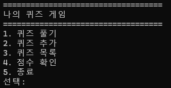

### 퀴즈 풀기
문제와 선택지, 정답·오답 안내를 표시합니다. 정답 번호의 범위를 벗어나면 다시 입력받습니다.

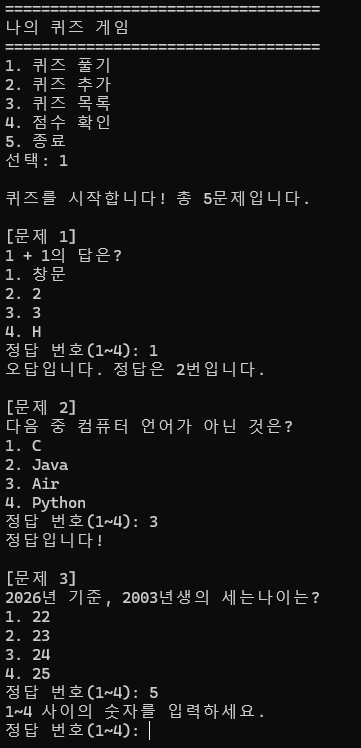

### 풀이 결과
5문제 중 3문제를 맞혀 최고 점수 3점을 기록하고 파일에 저장했습니다.

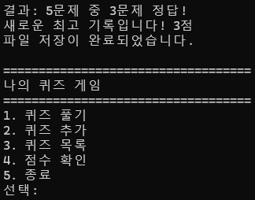

### 퀴즈 추가
새 문제 '3+3=?'와 선택지 4개, 정답 번호를 등록하고 저장했습니다.

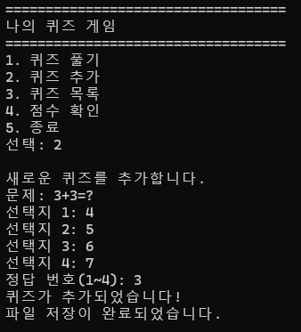

### 퀴즈 목록
추가한 문제를 포함하여 총 6문제가 표시됩니다.

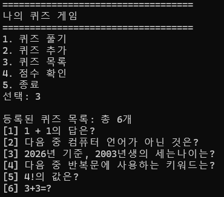

### 점수 확인
최고 점수 3점과 완료한 게임 1회를 표시합니다.

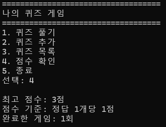

### 재실행 후 데이터 유지
프로그램을 종료한 뒤 다시 실행해도 추가한 문제와 점수가 유지됩니다.

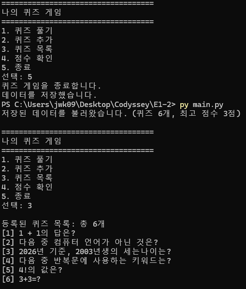

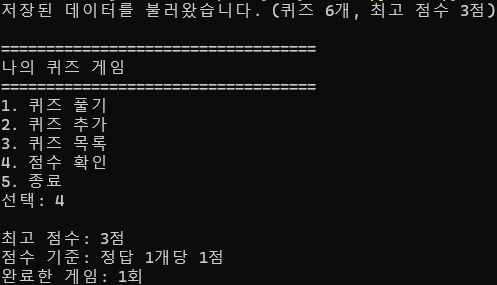

### 잘못된 입력 처리
메뉴에서 문자, 범위 밖 숫자, 빈 입력을 입력하면 안내하고 다시 입력받습니다.

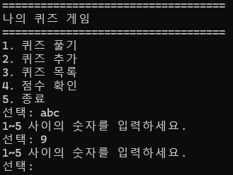

### 개발 환경
학습자의 실행 환경에서 Python 3.15.0, Git 2.55.0.windows.5 및 Git 작성자 설정을 확인했습니다.

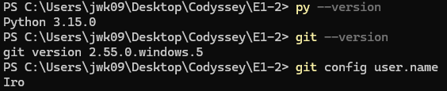

### Git 커밋과 브랜치 병합 기록
기능별 커밋과 `feature/play` 브랜치의 작업 및 병합 기록입니다.
아래 이미지는 촬영 시점의 기록이며, 이후 README 보완 커밋이 추가될 수 있습니다.

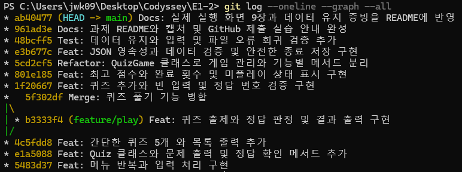

### 저장소 복제 실습 (clone)
원격 저장소를 별도 폴더 `E1-2-clone-practice`로 복제했습니다.

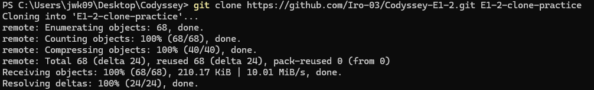

### 복제 폴더에서 push 후 원래 프로젝트에서 pull
복제 폴더에서 README 변경사항을 커밋·업로드한 뒤, 원래 `E1-2` 폴더에서
`git pull origin main`으로 해당 커밋을 받아 Fast-forward로 반영했습니다.
PowerShell 출력의 한글은 UTF-8을 명시하여 정상적으로 확인했습니다.

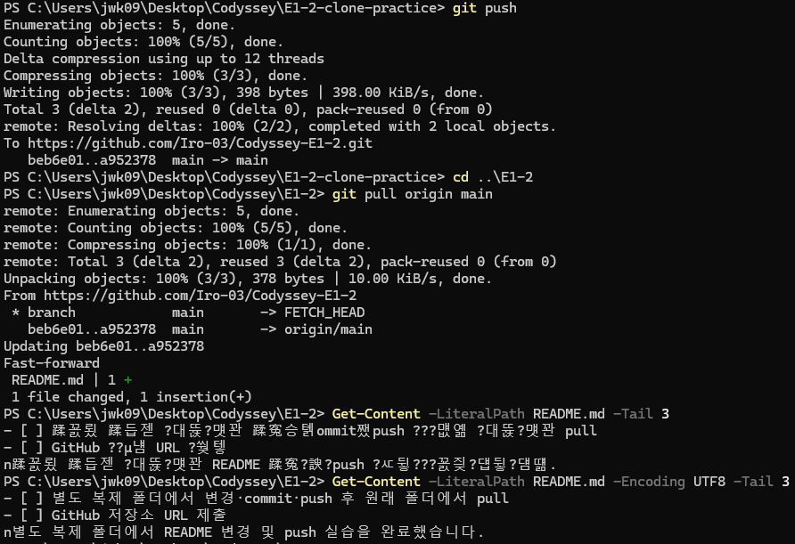

촬영 방법은 [스크린샷 안내](docs/screenshots/README.md)를 참고하세요.

## 보너스 실행 화면

### 확장 메뉴

퀴즈 삭제와 게임 기록을 포함한 메뉴 1~7번입니다.

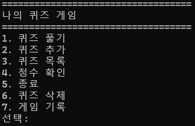

### 문제 수 선택과 무작위 출제

등록된 6문제 중 3문제를 선택하고, 등록 순서와 다른 순서로 출제한 결과입니다.
3문제 모두 정답이며 최종 점수 3점으로 저장했습니다.

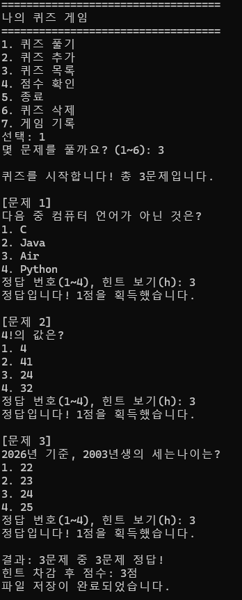

### 힌트와 점수 차감

`h`로 힌트를 확인한 문제는 맞혀도 0점입니다.
3문제를 모두 맞혔지만 한 문제에서 힌트를 사용하여 최종 점수는 2점입니다.

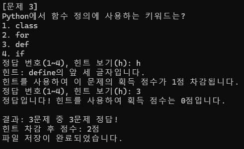

### 퀴즈 삭제

선택한 문제를 삭제 확인 후 저장하고, 목록이 6개에서 5개로 줄어든 것을 확인했습니다.

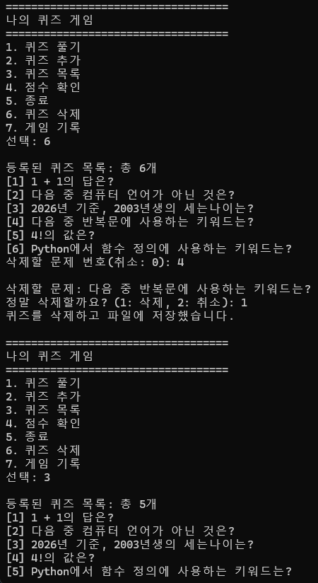

### 게임 기록 조회

완료한 게임 4회의 날짜·시간, 출제 문제 수, 정답 수, 힌트 차감 후 점수를 최신순으로 표시합니다.

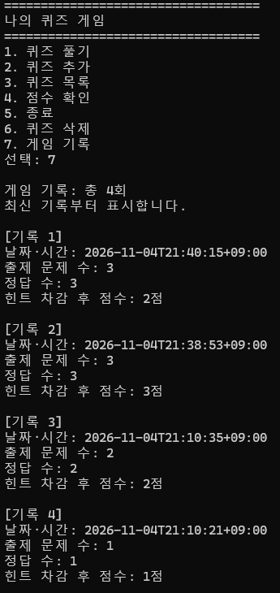

## 검증 방법
프로젝트 폴더에서 실행합니다.

```powershell
python -m unittest discover -s tests -v
```

Windows에서는 `python` 대신 `py`를 사용할 수 있습니다.
기존 15개 테스트를 변경된 입력 흐름에 맞춰 수정하고 보너스 검증 6개를 추가했습니다.
학습자 환경(Python 3.15.0)에서 **21개 테스트 통과(OK)**를 확인했습니다.
무작위 선택의 개수·중복, 힌트 차감과 최고 점수, 삭제 취소·저장 실패 시 복구,
힌트·히스토리의 재실행 유지와 이전 데이터 호환을 검증합니다.

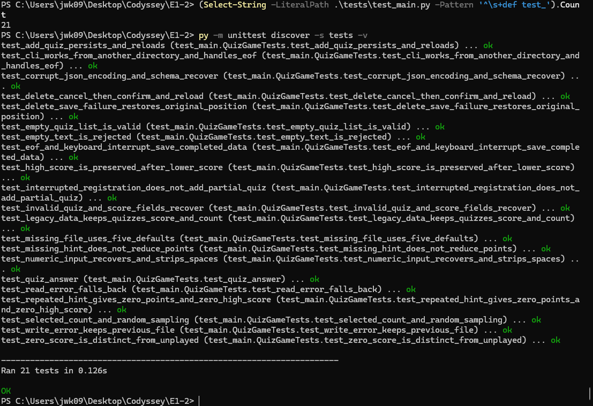

테스트는 프로젝트 안의 임시 폴더를 사용하며 제출용 `state.json`을 변경하지 않습니다.
버전별 검증 범위는 [검증 기록](docs/verification.md)에 정리했습니다.

## Git 및 제출
기존 기능별 커밋과 `feature/play` 브랜치 생성·병합 기록을 유지했습니다.
학습자가 GitHub에 업로드하고, 별도 폴더에서 clone → README 변경 → commit → push를 수행한 뒤 원래 프로젝트에서 pull하여 변경사항을 반영했습니다.

저장소: [Iro-03/Codyssey-E1-2](https://github.com/Iro-03/Codyssey-E1-2)
단계별 명령은 [GitHub 제출 안내](docs/github_submission.md)를 참고하세요.

- [x] 기본 퀴즈 5개, 클래스 2개, 메뉴와 필수 기능 구현
- [x] 데이터 저장·불러오기 및 입력·파일 오류 처리
- [x] README 필수 항목 작성
- [x] 기능별 커밋 10개 이상 및 브랜치 병합 기록
- [x] 직접 촬영한 실행 화면과 재실행 데이터 유지 증빙 9장 추가
- [x] 개발 환경·Git 그래프 캡처 추가
- [x] GitHub 저장소 생성 및 최초 push
- [x] 별도 복제 폴더에서 변경·commit·push 후 원래 폴더에서 pull
- [x] GitHub 저장소 URL 제출
별도 복제 폴더에서 README 변경 및 push 실습을 완료했습니다.


### 커밋 단위 규칙과 메시지 템플릿

한 커밋은 하나의 설명 가능한 변경을 담습니다. 예를 들어 '문제 수 선택'과 '힌트 점수 오류 수정'은
각각 기록하고, 동작을 검증하는 테스트와 관련 설명은 같은 목적의 커밋에 포함할 수 있습니다.
등록·플레이·저장·문서 수정을 이유 없이 섞거나, 횟수만 맞추는 빈 커밋과 `수정`, `완료` 같은 메시지는 피합니다.
커밋 전 `git diff`와 해당 변경의 테스트를 확인합니다.

메시지 형식은 **`타입: 구체적인 변경 요약`**으로 통일합니다.

```text
Feat: 문제 수 선택과 중복 없는 무작위 출제 구현
Fix: 최고 점수 비교에 힌트 차감 후 점수 적용
Refactor: QuizGame 메서드로 저장 책임 분리
Test: 힌트 사용 후 최고 점수와 재실행 유지 검증
Docs: JSON 선택 이유와 대규모 처리 한계 설명
Chore: Python 캐시 파일 제외 규칙 추가
```

타입은 새 기능 Feat, 오류 수정 Fix, 동작 유지 구조 개선 Refactor, 테스트 Test,
문서 Docs, 환경·관리 Chore입니다. 병합 커밋은 `Merge: 보너스 기능 병합`처럼 목적을 적습니다.
복잡한 변경은 본문에 '변경 이유 / 변경 내용 / 확인한 테스트 / 데이터 호환 영향'을 덧붙입니다.
기능 브랜치에서 구현·검증·커밋하고 main에 병합합니다. 기존 이력을 이 규칙에 맞추려고 재작성하지 않습니다.

### Git 원본 출력 증빙

문서 보완 전 기준 커밋은 `08a4cdf`입니다. 해당 시점의 병합 제외 커밋은
로컬 HEAD **25개**, 원격 추적 origin/main **25개**였습니다.
origin/main은 마지막 fetch/pull 기준 로컬 참조이며 실시간 서버 조회 결과가 아닙니다.
실제 명령과 전체 그래프는 [Git 원본 출력](docs/git-evidence.txt)에 첨부했습니다.
clone/pull 증빙은 위 실제 캡처를 사용하며 과거 터미널 출력을 새로 실행한 것처럼 만들지 않습니다.

최종 업로드 후 원격 추적 참조를 갱신하고 제출용 커밋 개수를 직접 촬영할 수 있습니다.

```powershell
git fetch origin
git rev-list --count --no-merges origin/main
git log --oneline --graph --all
```

## 보너스 기능

학습자가 직접 구현한 기능이며, 자동 테스트 21개와 실제 실행 화면을 확인했습니다.

- [x] 무작위 출제: random.sample으로 매 게임 문제를 무작위 선택 및 출제
- [x] 문제 수 선택: 등록된 문제 수 범위에서 출제 개수 선택
- [x] 힌트: hint 속성, 풀이 중 h 입력, 문제별 점수 차감
- [x] 퀴즈 삭제: 문제 선택·삭제 확인·파일 반영 및 실패 시 복구
- [x] 게임 기록: 날짜·시간, 문제 수, 정답 수, 최종 점수 저장 및 최신순 조회

### 보너스 버전 마무리

- [x] 최고 기록 갱신 기준을 힌트 차감 후 game_score로 통일
- [x] 변경된 입력 흐름과 보너스 기능에 맞춰 자동 테스트 수정 및 실행 (21개 통과)
- [x] 문제 수 선택·힌트 사용·삭제·게임 기록의 실제 실행 화면 추가 (5장)
